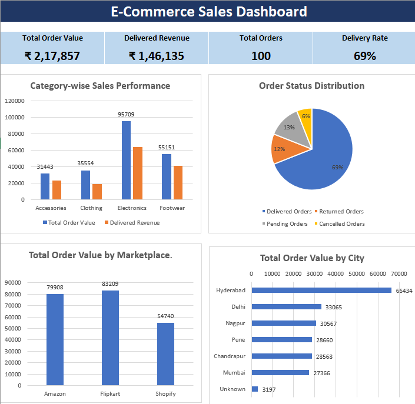

# E-Commerce Sales and Order Analysis

## Project Overview
An e-commerce data analytics project focused on data cleaning, sales performance, order management, and business insights using Microsoft Excel.

## Project Objectives
- Clean and standardize raw sales data.
- Analyze sales performance across categories, cities, and marketplaces.
- Evaluate delivery, return, and cancellation rates.
- Build an interactive Excel dashboard.
- Identify meaningful business insights.

## Dataset
- Source: Synthetic e-commerce dataset
- Raw records: 102
- Cleaned records: 100
- Duplicate records removed: 2

## Tools and Skills
- Microsoft Excel
- Data Cleaning and Validation
- Excel Tables
- SUMIF, SUMIFS, COUNTIF, COUNTIFS
- PivotTables and PivotCharts
- Dashboard Development
- Business Data Analysis

## Key Performance Indicators

| Metric | Value |
|---|---:|
| Total Order Value | ₹2,17,857 |
| Delivered Revenue | ₹1,46,135 |
| Total Orders | 100 |
| Delivery Rate | 69% |
| Return Rate | 12% |
| Cancellation Rate | 6% |
| Pending Order Rate | 13% |

## Dashboard

## Key Business Insights
- Electronics generated the highest total order value of ₹95,709.
- Flipkart recorded the highest marketplace order value of ₹83,209.
- Hyderabad generated the highest city-wise order value of ₹66,434.
- Shopify recorded the highest average order value of ₹2,380.
- Electronics recorded the highest category-wise return rate of 17.5%.

## Project Files
- `ecommerce_sales_raw.csv` - Original dataset
- `sales_analysis.xlsx` - Excel analysis and dashboard
- `dashboard.png` - Dashboard preview

## Project Status
- Excel Analysis: Completed
- SQL Analysis: Planned

## Disclaimer
This project uses synthetic data for educational and portfolio purposes.

